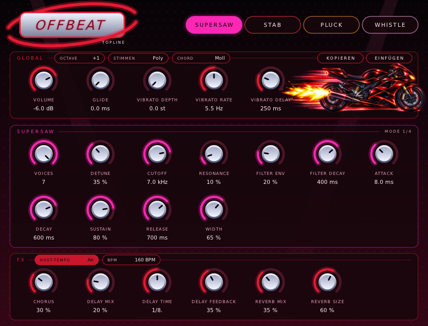
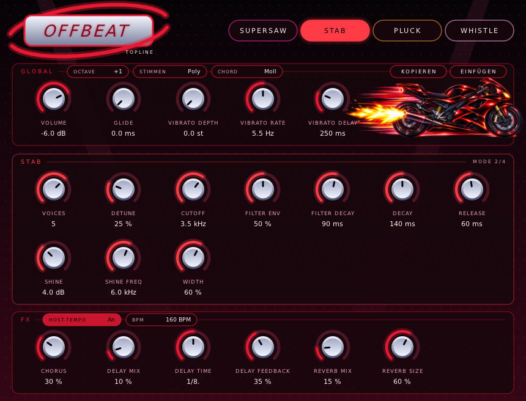
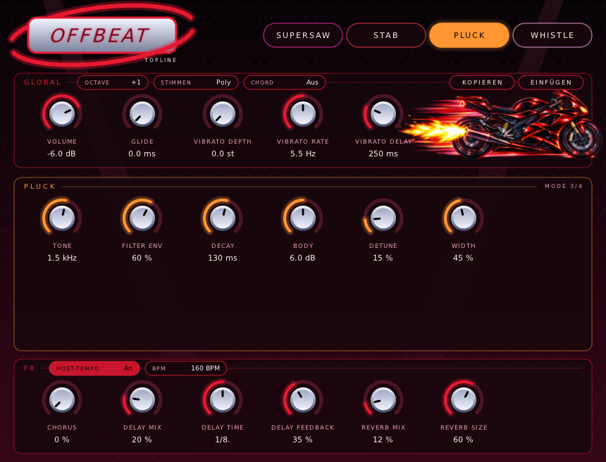
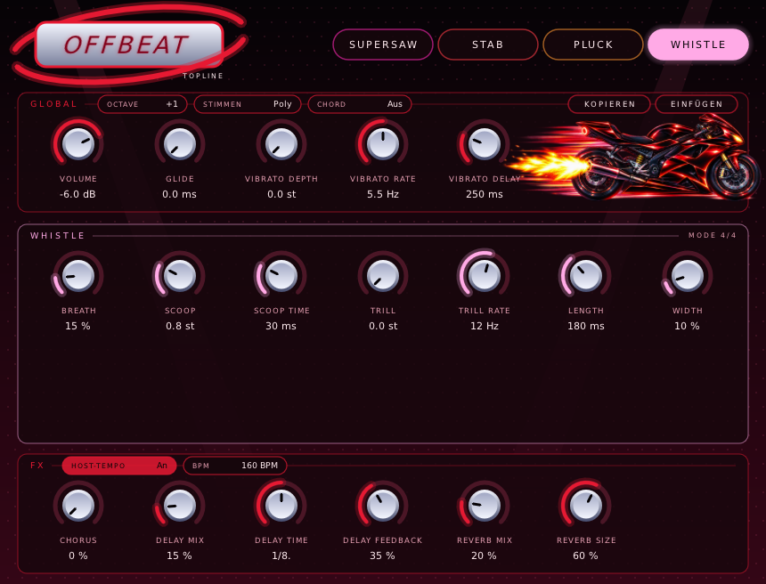

# Offbeat Topline

**Melodie-Synth für Hard Bounce und Bounce Techno:**
- breite Supersaw-Leads und -Akkorde,
- kurze Chord-Stabs mit Glanz,
- perkussive Plucks,
- die Rave-Trillerpfeife.

Teil der [Offbeat-Familie](https://github.com/lukestark-glitch/offbeat).



| Formate | Systeme | Lizenz |
|---|---|---|
| VST3 · VST2 · AU · CLAP · LV2 | macOS (Intel + Apple Silicon) · Windows · Linux | ISC (frei nutzbar) |

## Inhalt

- [Was kann Offbeat Topline?](#was-kann-offbeat-topline)
- [Installation](#installation)
- [Bedienung](#bedienung)
- [Alle Regler](#alle-regler): [Global](#global) · [FX](#fx) · [Supersaw](#supersaw) · [Stab](#stab) · [Pluck](#pluck) · [Whistle](#whistle)
- [Einstellungen als JSON](#einstellungen-als-json-kopieren--einfügen)
- [Presets zum Kopieren](#presets-zum-kopieren)
- [Selbst bauen und anpassen](#selbst-bauen-und-anpassen)

## Was kann Offbeat Topline?

| Modus | Klang | Ziel (gemessen an Referenz-Tracks) |
|---|---|---|
| **Supersaw** | bis 7 verstimmte Sägezähne pro Note, langer Release, Hall | sehr breit (L/R-Korrelation ≈ 0,5), Release 0,5–0,9 s, Tonbereich B4–E6 |
| **Stab** | mehrstimmige kurze Stöße, Glanz-EQ 4–8 kHz | 70–200 ms, breit (≈ 0,6) |
| **Pluck** | perkussiv, kräftige Mitten um 1 kHz | ≈ 90 ms, fast mono (≈ 0,9) |
| **Whistle** | Sinus + Atemrauschen, rutscht von unten in den Ton, optional Triller | Grundton per Taste (D#7 ≈ 2,5 kHz), Stöße 100–250 ms |

<p>
  
  
</p>
<p></p>

Für alle Modi gibt es:
- **Spielweise:** Chord-Hold (Moll, Dur, Moll7, Dur7), Poly oder Mono mit Legato, Glide, Vibrato mit Einsatzverzögerung.
- **Effekte:** Chorus, Ping-Pong-Delay im Takt und Hall.
- **Breite:** Width pro Modus, unter 150 Hz immer mono.
- **Presets:** 10 Stück in F-Moll sowie A-Dur und E-Dur.
- **Bedienung:** Zahleneingabe an jedem Regler, JSON zum Kopieren und Einfügen.

## Installation

**Kurz:** Lade unter [Releases](https://github.com/lukestark-glitch/offbeat-topline/releases) das ZIP für dein System, kopiere das passende Format in den Plugin-Ordner und lass deine DAW neu scannen.

| System | VST3 | AU | CLAP |
|---|---|---|---|
| macOS | `~/Library/Audio/Plug-Ins/VST3/` | `~/Library/Audio/Plug-Ins/Components/` | `~/Library/Audio/Plug-Ins/CLAP/` |
| Windows | `C:\Program Files\Common Files\VST3\` | – | `C:\Program Files\Common Files\CLAP\` |
| Linux | `~/.vst3/` | – | `~/.clap/` |

> **Octave:** Der Standard **+1** ist für LMMS gedacht, weil LMMS Noten eine Oktave zu tief schickt. **In FL Studio, Ableton, Logic, Bitwig und Reaper stellst du Octave auf 0.**

Ausführlich für alle Systeme und DAWs: **[Setup-Anleitung](https://github.com/lukestark-glitch/offbeat/blob/main/SETUP.md)**.

## Bedienung

| Aktion | Wirkung |
|---|---|
| Regler hoch/runter ziehen | Wert ändern; mit **Shift** fein |
| Mausrad | in kleinen Schritten ändern |
| Doppelklick | Standardwert |
| Klick auf den Wert (oder Rechtsklick) | **Zahl eintippen** (z. B. `50` für 50 %, `1.5k` für 1500 Hz, `Moll7`), Enter übernimmt |
| Kleine Felder in den Kopfzeilen | ziehen ändert; ein Klick ohne Ziehen öffnet die Eingabe |
| Reiter oben | Modus wechseln |
| **KOPIEREN / EINFÜGEN** | Einstellungen als JSON über die Zwischenablage |

Presets wählst du in der Preset-Liste der DAW. Die Taste im Namen, z. B. „(F5)“, ist die gedachte Grundtaste.

## Alle Regler

### Global

| Regler | Bereich | Standard | Was er verändert | Beispiel |
|---|---|---|---|---|
| Mode | Supersaw … Whistle | Supersaw | welcher Klang gespielt wird | Reiter „Pluck“ |
| Volume | −40 … +6 dB | −6 dB | Lautstärke am Ausgang (Limiter danach) | 0 dB, wenn Topline neben der Engine zu leise ist |
| Octave | −2 … +2 | +1 | verschiebt alle Noten in Oktaven | 0 in FL/Ableton/Logic, +1 in LMMS |
| Stimmen | Poly / Mono | Poly | Mono: Legato. Eine neue Taste bei gehaltener gleitet ohne Neuanschlag hin, beim Loslassen zurück | Mono + Glide 90 ms für einen Lead |
| Glide | 0 … 500 ms | 0 ms | Gleiten zur neuen Note | 60 ms für Rutscher in der Melodie |
| Chord | Aus / Moll / Dur / Moll7 / Dur7 | Aus | eine Taste spielt einen Akkord (7 = kleine Septime) | Moll: F spielt F–As–C |
| Vibrato Depth | 0 … 1 st | 0 | Stärke des Vibratos | 0,25 st für einen singenden Lead |
| Vibrato Rate | 1 … 10 Hz | 5,5 Hz | Tempo des Vibratos | 7 Hz für nervöser |
| Vibrato Delay | 0 … 1000 ms | 250 ms | ab wann das Vibrato einsetzt (blendet über 200 ms ein) | 500 ms: nur lange Noten vibrieren |

### FX

| Regler | Bereich | Standard | Was er verändert | Beispiel |
|---|---|---|---|---|
| Chorus | 0 … 100 % | 30 % | Stereo-Chorus | 0 % für einen trockenen Pluck |
| Delay Mix | 0 … 100 % | 15 % | Lautstärke des Ping-Pong-Echos | 30 % für hörbare Echos zwischen den Noten |
| Delay Time | 1/16 · 1/8 · 1/8. · 1/4 · 1/4. | 1/8. | Echo-Zeit im Takt | 1/8. (punktiert) klingt bei 160 BPM besonders „bouncy“ |
| Delay Feedback | 0 … 90 % | 35 % | wie viele Wiederholungen | 60 % für lange Echo-Fahnen |
| Reverb Mix | 0 … 100 % | 25 % | Hall-Anteil | 40 % für hymnische Akkorde |
| Reverb Size | 0 … 100 % | 60 % | Hall-Länge | 90 % für einen Halle-Sound |
| Host-Tempo | An/Aus | An | Echo-Zeit nach DAW-Tempo; aus = nach BPM | aus, wenn das Delay nicht zum Song passt |
| BPM | 60 … 220 | 160 | Tempo fürs Echo ohne Host-Tempo | 150 |

### Supersaw

| Regler | Bereich | Standard | Was er verändert | Beispiel |
|---|---|---|---|---|
| Voices | 1 … 7 | 7 | Sägezähne pro Note | 3 für einen schlankeren Lead |
| Detune | 0 … 100 % | 35 % | Verstimmung; mehr = breiter, schwebender | 50 % für den „Euphorie“-Sound |
| Cutoff | 200 Hz … 18 kHz | 7 kHz | Helligkeit | 3 kHz für weichere Akkorde |
| Resonance | 0 … 100 % | 10 % | Betonung an der Filterfrequenz | 40 % für einen „singenden“ Filter |
| Filter Env | 0 … 100 % | 20 % | Filter öffnet beim Anschlag | 50 % für einen stärkeren Anschlag |
| Filter Decay | 5 … 3000 ms | 400 ms | wie schnell es wieder zugeht | 150 ms für kurzes „Blitzen“ |
| Attack | 0,5 … 2000 ms | 8 ms | Einschwingen | 200 ms für anschwellende Akkorde |
| Decay | 5 … 3000 ms | 600 ms | Abfall nach dem Anschlag | 300 ms |
| Sustain | 0 … 100 % | 80 % | Pegel beim Halten | 100 % für Flächen |
| Release | 10 … 5000 ms | 700 ms | Ausklingen nach dem Loslassen (Referenz 0,5–0,9 s) | 1500 ms für Breakdowns |
| Width | 0 … 100 % | 65 % | Stereobreite (65 % ≈ Korrelation 0,5) | 85 % für sehr breit |

### Stab

| Regler | Bereich | Standard | Was er verändert | Beispiel |
|---|---|---|---|---|
| Voices / Detune | 1 … 7 / 0 … 100 % | 5 / 25 % | wie bei Supersaw | 7 / 40 % für fettere Stabs |
| Cutoff | 200 Hz … 18 kHz | 3,5 kHz | Helligkeit | 2,5 kHz für dunkler |
| Filter Env | 0 … 100 % | 50 % | „Pling“ am Anfang | 80 % für mehr Attack |
| Filter Decay | 5 … 1000 ms | 90 ms | Länge des „Pling“ | 40 ms für sehr knackig |
| Decay | 20 … 1000 ms | 140 ms | Länge des Stoßes | 250 ms für längere Stabs |
| Release | 5 … 1000 ms | 60 ms | Ausklingen nach dem Loslassen | 150 ms |
| Shine | 0 … 12 dB | 4 dB | Glanz: Anhebung in den Höhen | 8 dB für „A-Dur Shine“ |
| Shine Freq | 4 … 8 kHz | 6 kHz | wo der Glanz sitzt | 7 kHz für luftiger |
| Width | 0 … 100 % | 60 % | Stereobreite (≈ Korrelation 0,6) | 40 % für mittiger |

### Pluck

| Regler | Bereich | Standard | Was er verändert | Beispiel |
|---|---|---|---|---|
| Tone | 200 Hz … 8 kHz | 1,5 kHz | Grundhelligkeit | 2,5 kHz für hellere Plucks |
| Filter Env | 0 … 100 % | 60 % | „Zupf“-Anteil | 90 % für einen harten Anschlag |
| Decay | 20 … 600 ms | 130 ms | Länge (≈ 90 ms bis −30 dB) | 250 ms für längere Töne |
| Body | 0 … 12 dB | 6 dB | Anhebung um 1 kHz (Mitten) | 10 dB, damit sich der Pluck im Mix durchsetzt |
| Detune | 0 … 100 % | 15 % | leichte Verstimmung (3 Sägezähne); 0 = ein Sägezahn | 0 % für einen ganz trockenen Pluck |
| Width | 0 … 100 % | 45 % | fast mono (≈ Korrelation 0,9) | 70 % für breiter |

### Whistle

Grundton per Taste: **D#7** ≈ 2,5 kHz wie die klassische Rave-Pfeife.

| Regler | Bereich | Standard | Was er verändert | Beispiel |
|---|---|---|---|---|
| Breath | 0 … 100 % | 15 % | Atemrauschen um den Grundton | 40 % für eine „echtere“ Pfeife |
| Scoop | 0 … 3 st | 0,8 st | Einsatz rutscht von so weit unten hoch | 2 st für einen deutlichen Rutscher |
| Scoop Time | 5 … 100 ms | 30 ms | wie schnell | 60 ms für langsamer |
| Trill | 0 … 3 st | 0 | Triller-Intervall (0 = aus) | 2 st für die Trillerpfeife |
| Trill Rate | 2 … 20 Hz | 12 Hz | Triller-Tempo | 16 Hz für sehr schnell |
| Length | 50 … 2000 ms | 180 ms | Länge eines Stoßes, auch wenn die Taste länger gehalten wird | 2000 ms für gehaltene Pfiffe |
| Width | 0 … 100 % | 10 % | Stereobreite | 0 % für mono |

## Einstellungen als JSON (KOPIEREN / EINFÜGEN)

- **KOPIEREN** legt Modus, GLOBAL, FX und die Regler des aktiven Modus als JSON in die Zwischenablage.
- **EINFÜGEN** setzt jeden genannten Regler. Was im JSON fehlt, bleibt, wie es ist.

```json
{
  "mode": "Stab",
  "chord": "Moll7",
  "stab_decay": 180,
  "stab_shine": 6,
  "reverb_mix": 0.2
}
```

**Regeln:**
- **Zahlen** stehen in der Einheit des Plugins.
- **%-Regler** werden als **0 … 1** geschrieben.
- **Auswahl-Regler** gehen als Name: `"mode": "Pluck"`, `"voice_mode": "Mono"`, `"chord": "Dur7"`, `"delay_time": "1/8."`.
- **Schalter** gehen als `true`/`false`.
- **Fehler:** Unbekannte Schlüssel meldet die Statuszeile.

| Bereich | Schlüssel |
|---|---|
| Global | `mode` `volume` `octave` `voice_mode` `glide` `chord` `vib_depth` `vib_rate` `vib_delay` |
| FX | `chorus` `delay_mix` `delay_time` `delay_fb` `reverb_mix` `reverb_size` `tempo_host` `tempo_bpm` |
| Supersaw | `saw_voices` `saw_detune` `saw_cutoff` `saw_reso` `saw_envamt` `saw_fdecay` `saw_attack` `saw_decay` `saw_sustain` `saw_release` `saw_width` |
| Stab | `stab_voices` `stab_detune` `stab_cutoff` `stab_envamt` `stab_fdecay` `stab_decay` `stab_release` `stab_shine` `stab_shine_hz` `stab_width` |
| Pluck | `pluck_tone` `pluck_envamt` `pluck_decay` `pluck_body` `pluck_detune` `pluck_width` |
| Whistle | `whistle_breath` `whistle_scoop` `whistle_scoop_ms` `whistle_trill` `whistle_trill_hz` `whistle_length` `whistle_width` |

Der Offline-Renderer versteht dasselbe: `bin/topline-render --json sound.json --note F5 --out sound.wav`.

## Presets zum Kopieren

Jedes Preset als JSON, genau so, wie KOPIEREN es ausgibt. Block kopieren und im Plugin **EINFÜGEN** drücken.

<details><summary><b>1. Supersaw - F-Moll Hymne (F5)</b></summary>

```json
{
  "mode": "Supersaw",
  "volume": -6,
  "octave": 1,
  "voice_mode": "Poly",
  "glide": 0,
  "chord": "Moll",
  "vib_depth": 0,
  "vib_rate": 5.5,
  "vib_delay": 250,
  "chorus": 0.3,
  "delay_mix": 0.2,
  "delay_time": "1/8.",
  "delay_fb": 0.35,
  "reverb_mix": 0.35,
  "reverb_size": 0.6,
  "tempo_host": true,
  "tempo_bpm": 160,
  "saw_voices": 7,
  "saw_detune": 0.35,
  "saw_cutoff": 7000,
  "saw_reso": 0.1,
  "saw_envamt": 0.2,
  "saw_fdecay": 400,
  "saw_attack": 8,
  "saw_decay": 600,
  "saw_sustain": 0.8,
  "saw_release": 700,
  "saw_width": 0.65
}
```

</details>
<details><summary><b>2. Supersaw - E-Dur Euphorie (E5)</b></summary>

```json
{
  "mode": "Supersaw",
  "volume": -6,
  "octave": 1,
  "voice_mode": "Poly",
  "glide": 0,
  "chord": "Dur",
  "vib_depth": 0,
  "vib_rate": 5.5,
  "vib_delay": 250,
  "chorus": 0.3,
  "delay_mix": 0.2,
  "delay_time": "1/8.",
  "delay_fb": 0.35,
  "reverb_mix": 0.35,
  "reverb_size": 0.6,
  "tempo_host": true,
  "tempo_bpm": 160,
  "saw_voices": 7,
  "saw_detune": 0.45,
  "saw_cutoff": 9000,
  "saw_reso": 0.1,
  "saw_envamt": 0.2,
  "saw_fdecay": 400,
  "saw_attack": 8,
  "saw_decay": 600,
  "saw_sustain": 0.8,
  "saw_release": 700,
  "saw_width": 0.65
}
```

</details>
<details><summary><b>3. Lead - Mono Glide</b></summary>

```json
{
  "mode": "Supersaw",
  "volume": -6,
  "octave": 1,
  "voice_mode": "Mono",
  "glide": 90,
  "chord": "Aus",
  "vib_depth": 0.25,
  "vib_rate": 5.5,
  "vib_delay": 250,
  "chorus": 0.3,
  "delay_mix": 0.15,
  "delay_time": "1/8.",
  "delay_fb": 0.35,
  "reverb_mix": 0.25,
  "reverb_size": 0.6,
  "tempo_host": true,
  "tempo_bpm": 160,
  "saw_voices": 5,
  "saw_detune": 0.25,
  "saw_cutoff": 7000,
  "saw_reso": 0.1,
  "saw_envamt": 0.2,
  "saw_fdecay": 400,
  "saw_attack": 8,
  "saw_decay": 600,
  "saw_sustain": 0.8,
  "saw_release": 600,
  "saw_width": 0.65
}
```

</details>
<details><summary><b>4. Stab - F-Moll Rave (F5)</b></summary>

```json
{
  "mode": "Stab",
  "volume": -6,
  "octave": 1,
  "voice_mode": "Poly",
  "glide": 0,
  "chord": "Moll",
  "vib_depth": 0,
  "vib_rate": 5.5,
  "vib_delay": 250,
  "chorus": 0.3,
  "delay_mix": 0.1,
  "delay_time": "1/8.",
  "delay_fb": 0.35,
  "reverb_mix": 0.15,
  "reverb_size": 0.6,
  "tempo_host": true,
  "tempo_bpm": 160,
  "stab_voices": 5,
  "stab_detune": 0.25,
  "stab_cutoff": 3500,
  "stab_envamt": 0.5,
  "stab_fdecay": 90,
  "stab_decay": 140,
  "stab_release": 60,
  "stab_shine": 4,
  "stab_shine_hz": 6000,
  "stab_width": 0.6
}
```

</details>
<details><summary><b>5. Stab - A-Dur Shine (A4)</b></summary>

```json
{
  "mode": "Stab",
  "volume": -6,
  "octave": 1,
  "voice_mode": "Poly",
  "glide": 0,
  "chord": "Dur",
  "vib_depth": 0,
  "vib_rate": 5.5,
  "vib_delay": 250,
  "chorus": 0.3,
  "delay_mix": 0.1,
  "delay_time": "1/8.",
  "delay_fb": 0.35,
  "reverb_mix": 0.15,
  "reverb_size": 0.6,
  "tempo_host": true,
  "tempo_bpm": 160,
  "stab_voices": 5,
  "stab_detune": 0.25,
  "stab_cutoff": 3500,
  "stab_envamt": 0.5,
  "stab_fdecay": 90,
  "stab_decay": 140,
  "stab_release": 60,
  "stab_shine": 8,
  "stab_shine_hz": 7000,
  "stab_width": 0.6
}
```

</details>
<details><summary><b>6. Stab - F-Moll7 Groove (F5)</b></summary>

```json
{
  "mode": "Stab",
  "volume": -6,
  "octave": 1,
  "voice_mode": "Poly",
  "glide": 0,
  "chord": "Moll7",
  "vib_depth": 0,
  "vib_rate": 5.5,
  "vib_delay": 250,
  "chorus": 0.3,
  "delay_mix": 0.15,
  "delay_time": "1/8.",
  "delay_fb": 0.35,
  "reverb_mix": 0.2,
  "reverb_size": 0.6,
  "tempo_host": true,
  "tempo_bpm": 160,
  "stab_voices": 5,
  "stab_detune": 0.25,
  "stab_cutoff": 2800,
  "stab_envamt": 0.5,
  "stab_fdecay": 90,
  "stab_decay": 180,
  "stab_release": 60,
  "stab_shine": 4,
  "stab_shine_hz": 6000,
  "stab_width": 0.6
}
```

</details>
<details><summary><b>7. Pluck - F-Moll (F5)</b></summary>

```json
{
  "mode": "Pluck",
  "volume": -6,
  "octave": 1,
  "voice_mode": "Poly",
  "glide": 0,
  "chord": "Aus",
  "vib_depth": 0,
  "vib_rate": 5.5,
  "vib_delay": 250,
  "chorus": 0,
  "delay_mix": 0.2,
  "delay_time": "1/8.",
  "delay_fb": 0.35,
  "reverb_mix": 0.12,
  "reverb_size": 0.6,
  "tempo_host": true,
  "tempo_bpm": 160,
  "pluck_tone": 1500,
  "pluck_envamt": 0.6,
  "pluck_decay": 130,
  "pluck_body": 6,
  "pluck_detune": 0.15,
  "pluck_width": 0.45
}
```

</details>
<details><summary><b>8. Pluck - E-Dur Chords (E5)</b></summary>

```json
{
  "mode": "Pluck",
  "volume": -6,
  "octave": 1,
  "voice_mode": "Poly",
  "glide": 0,
  "chord": "Dur",
  "vib_depth": 0,
  "vib_rate": 5.5,
  "vib_delay": 250,
  "chorus": 0,
  "delay_mix": 0.15,
  "delay_time": "1/8.",
  "delay_fb": 0.35,
  "reverb_mix": 0.12,
  "reverb_size": 0.6,
  "tempo_host": true,
  "tempo_bpm": 160,
  "pluck_tone": 2000,
  "pluck_envamt": 0.6,
  "pluck_decay": 130,
  "pluck_body": 6,
  "pluck_detune": 0.15,
  "pluck_width": 0.45
}
```

</details>
<details><summary><b>9. Whistle - Rave Pfeife (D#7)</b></summary>

```json
{
  "mode": "Whistle",
  "volume": -6,
  "octave": 1,
  "voice_mode": "Poly",
  "glide": 0,
  "chord": "Aus",
  "vib_depth": 0,
  "vib_rate": 5.5,
  "vib_delay": 250,
  "chorus": 0,
  "delay_mix": 0.15,
  "delay_time": "1/8.",
  "delay_fb": 0.35,
  "reverb_mix": 0.2,
  "reverb_size": 0.6,
  "tempo_host": true,
  "tempo_bpm": 160,
  "whistle_breath": 0.15,
  "whistle_scoop": 0.8,
  "whistle_scoop_ms": 30,
  "whistle_trill": 0,
  "whistle_trill_hz": 12,
  "whistle_length": 180,
  "whistle_width": 0.1
}
```

</details>
<details><summary><b>10. Whistle - Triller (D#7)</b></summary>

```json
{
  "mode": "Whistle",
  "volume": -6,
  "octave": 1,
  "voice_mode": "Poly",
  "glide": 0,
  "chord": "Aus",
  "vib_depth": 0,
  "vib_rate": 5.5,
  "vib_delay": 250,
  "chorus": 0,
  "delay_mix": 0.1,
  "delay_time": "1/8.",
  "delay_fb": 0.35,
  "reverb_mix": 0.2,
  "reverb_size": 0.6,
  "tempo_host": true,
  "tempo_bpm": 160,
  "whistle_breath": 0.15,
  "whistle_scoop": 0.8,
  "whistle_scoop_ms": 30,
  "whistle_trill": 2,
  "whistle_trill_hz": 12,
  "whistle_length": 600,
  "whistle_width": 0.1
}
```

</details>

## Selbst bauen und anpassen

```sh
git clone --recurse-submodules https://github.com/lukestark-glitch/offbeat-topline
cd offbeat-topline
make          # alle Formate nach bin/ + Offline-Renderer
make check    # alle 10 Presets rendern und gegen die Klangziele prüfen
make install  # macOS: in ~/Library/Audio/Plug-Ins kopieren und signieren
```

Windows/Linux: siehe [Setup-Anleitung](https://github.com/lukestark-glitch/offbeat/blob/main/SETUP.md#5-selbst-bauen). Aufbau des Codes und Anleitungen zum Anpassen: **[docs/CODE.md](docs/CODE.md)**.

## Lizenz

[ISC](LICENSE): Du darfst den Code und die Plugins frei nutzen, verändern und weitergeben, auch kommerziell.
